# Sitio Web Estático con Amazon S3 + CloudFront

Despliegue de un sitio web estático utilizando **Amazon S3** como almacenamiento de los ficheros del sitio y **Amazon CloudFront** como CDN para distribuirlo de forma rápida y segura (HTTPS).

🔗 **Demo en vivo (Netlify):** https://homer-simpsons-page.netlify.app/
> Este enlace es un despliegue aparte en Netlify (con HTTPS ya incluido por defecto), usado como referencia rápida de la web. No forma parte de la infraestructura AWS documentada en este repositorio.

## 📐 Arquitectura

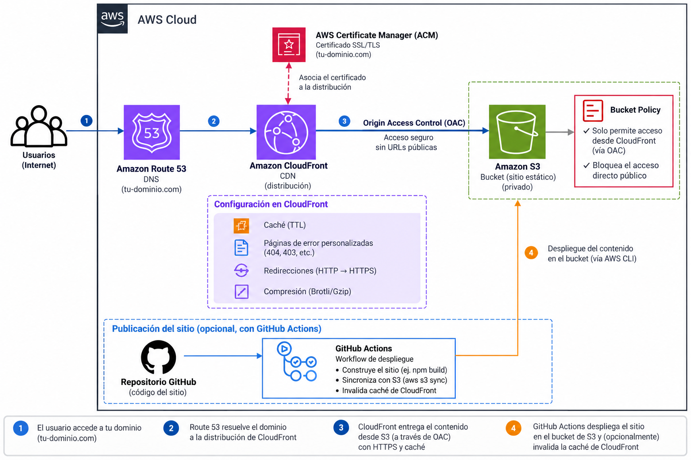

Este es el diseño final del proyecto (ver **Parte 2** más abajo): el acceso directo al bucket de S3 está bloqueado, y solo se permite el acceso a través de **CloudFront** mediante **Origin Access Control (OAC)** y una **Bucket Policy** restrictiva.

> ℹ️ Durante el proyecto se pasó primero por una versión con el bucket **público** (Static Website Hosting sin CloudFront, documentada en la **Parte 1**) para comprobar en primera persona sus limitaciones (sin HTTPS, coste por tráfico directo), antes de revertirla y llegar a este diseño final con OAC.

## 🎯 Objetivo del proyecto

- Alojar un sitio web estático (HTML/CSS/JS) en un bucket de S3.
- Servirlo a través de CloudFront para mejorar el rendimiento y añadir HTTPS — **el endpoint de S3 Website Hosting por sí solo no soporta SSL/TLS**, por lo que alojar un sitio ahí sin CloudFront por delante no es buena práctica (el tráfico va sin cifrar).
- Restringir el acceso directo al bucket (solo accesible a través de CloudFront).
- Documentar el proceso completo paso a paso con capturas de pantalla.

## 🌐 Sitio web

El sitio desplegado es la **"Homer's Web Page"**, una página estática (HTML/CSS/JS) ubicada en [`homers-web-page-master/`](homers-web-page-master/):

```
homers-web-page-master/
├── index.html
├── estilo.css
├── fuentes/   (fuente Cooper Black)
├── gifs/      (animaciones)
├── img/       (imágenes del telón e icono)
├── js/        (code.js)
└── sonidos/   (audio de fondo)
```

> ⚠️ Nota de licencias: las fuentes Cooper Black incluidas (`COOPBL.TTF` de Microsoft y `CooperBlackStd.otf` de Adobe) son fuentes comerciales con copyright de terceros. Se mantienen en el repositorio por tratarse de un proyecto personal/educativo, sin uso comercial.

### 🔄 Cómo actualizar el sitio

En S3 **no se pueden editar los archivos directamente desde la consola** (no hay un editor de texto in situ para HTML/CSS/JS). Para publicar cualquier cambio hay que:

1. Modificar el fichero localmente (en [`homers-web-page-master/`](homers-web-page-master/)).
2. **Volver a subirlo (sobrescribirlo) al bucket de S3** con el mismo nombre/ruta.
3. Si la distribución de CloudFront ya sirvió antes ese fichero, lo tiene **cacheado** en el edge: el cambio no se ve de inmediato en el navegador hasta que expira el TTL de caché. Para verlo al instante hay que crear una **invalidación de caché**.

La pestaña **Error pages** confirma la regla creada en el [paso 6](#6-creación-de-la-distribución-de-cloudfront) (403 → `/index.html` → 200):

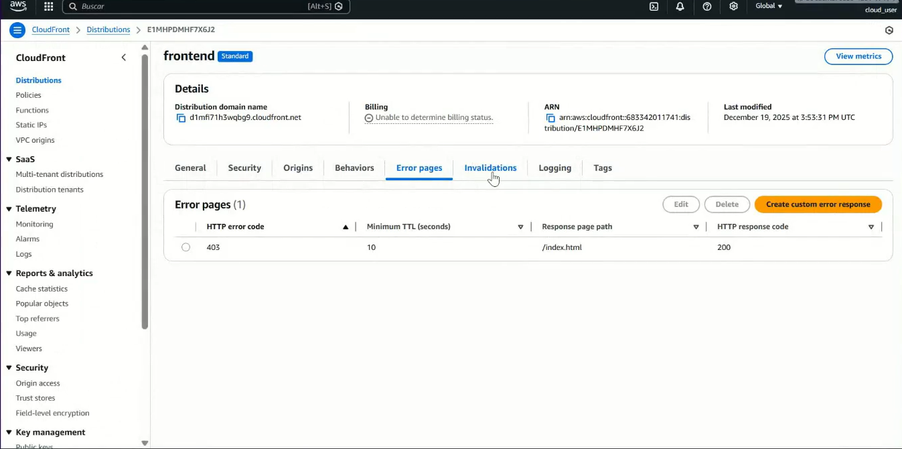

Para la invalidación: pestaña **Invalidations** → `Create invalidation` → se indica la ruta a invalidar en **Object paths**:

- `/*` → invalida **todo** el contenido cacheado (más simple, pero fuerza a recargar todo desde el origen).
- Un path exacto (p. ej. `/index.html`) → invalida **solo ese fichero**, más eficiente si solo ha cambiado uno.

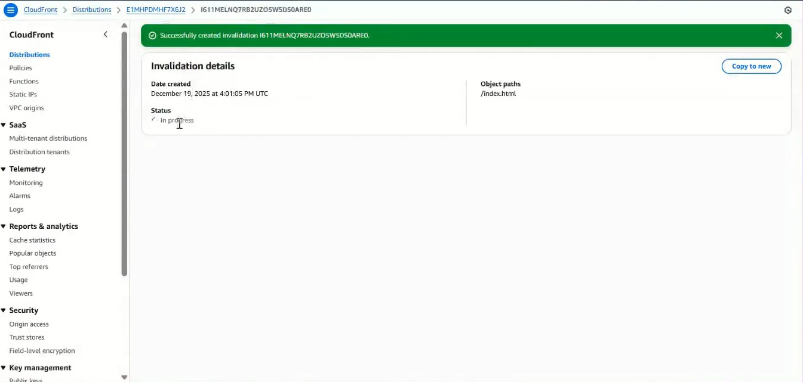

AWS confirma *"Successfully created invalidation"*; el estado pasa a **In progress** y, al completarse, la próxima petición a ese path se sirve ya desde el origen (contenido actualizado) en lugar de la copia cacheada.

> ⚠️ Importante: al invalidar un path, CloudFront **descarta la copia cacheada** y, en la siguiente visita, tiene que **volver a pedir ese fichero al bucket de S3** (una nueva solicitud al origen) para recachearlo. Es decir, cada invalidación "cuesta" al menos una petición extra a S3 — por eso conviene invalidar solo los paths que realmente han cambiado (en vez de `/*` siempre) y no abusar de las invalidaciones en despliegues muy frecuentes.

## 🛠️ Servicios de AWS utilizados

- **Amazon S3** — almacenamiento del contenido estático.
- **Amazon CloudFront** — distribución del contenido (CDN) y HTTPS.
- **AWS Certificate Manager (ACM)** — certificado SSL/TLS (si se usa dominio propio).
- **Amazon Route 53** — gestión del dominio (si aplica).
- **IAM** — políticas de acceso al bucket.

> 💡 **Alternativa: AWS Amplify.** AWS ofrece **Amplify Hosting**, pensado para quien no quiere gestionar la infraestructura manualmente: en pocos clics levanta algo equivalente a este S3 + CloudFront (almacenamiento + CDN + HTTPS) de forma gestionada, incluso con CI/CD conectado a un repositorio Git. En este proyecto se monta todo manualmente (S3, bucket policy, OAC, CloudFront) **a propósito**, con fines didácticos, para entender cómo funciona cada pieza por debajo.

## ✅ Requisitos previos

- Cuenta de AWS.
- AWS CLI instalado y configurado (opcional, para despliegues por línea de comandos).
- Un dominio propio (opcional, si se quiere usar un nombre de dominio personalizado en vez de la URL de CloudFront).

## 📋 Pasos realizados

> Esta sección se irá completando con cada paso del proyecto, junto con sus capturas de pantalla correspondientes.

## 🥇 Parte 1: Alojar la web directamente en el bucket S3 (enfoque ingenuo)

Primero se aloja el sitio usando únicamente **S3 Static Website Hosting**, sin CloudFront por delante. Esta parte sirve para comprobar en primera persona **por qué no es buena práctica** dejarlo así en producción (sin HTTPS y con coste por tráfico directo al origen).

### 1. Creación del bucket S3

Se crea un bucket de **Uso general** (tipo recomendado para este caso de uso), con espacio de nombres global.

> Nota: en el formulario de creación se mostraba por defecto la región Europa (Estocolmo) `eu-north-1`, pero el bucket se creó finalmente en **Europa (Irlanda) `eu-west-1`**, confirmado en la pestaña Propiedades del bucket.

- **Nombre del bucket:** `demo-web-estatica-proyecto`
- **Propiedad del objeto:** ACL deshabilitadas (recomendado) — todos los objetos pertenecen a esta cuenta y el acceso se gestiona solo mediante políticas (bucket policy), no mediante ACLs.

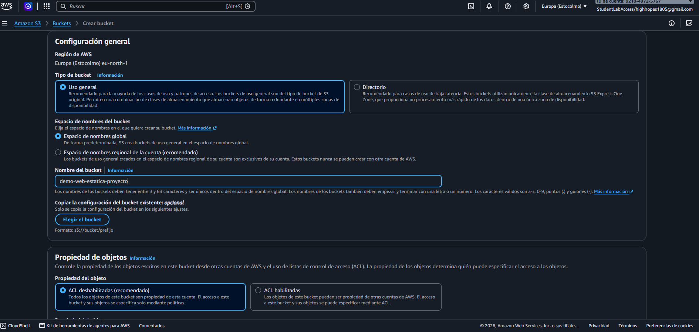

### 2. Subida de los ficheros del sitio

Se sube el contenido de [`homers-web-page-master/`](homers-web-page-master/) directamente a la raíz del bucket, conservando la estructura de subcarpetas (`fuentes/`, `gifs/`, `img/`, `js/`, `sonidos/`) para que las rutas relativas de `index.html` y `estilo.css` sigan funcionando.

- **25 archivos, 3.2 MB** subidos correctamente (`index.html`, `estilo.css` y los recursos en sus subcarpetas).

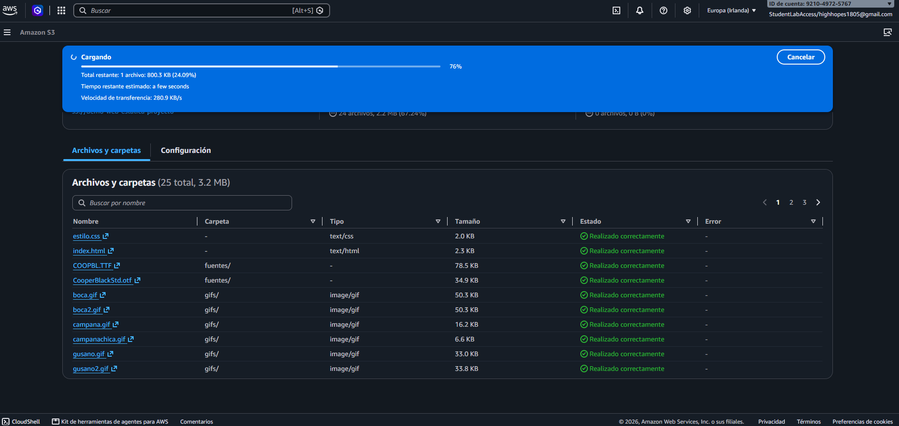

Resultado final en la raíz del bucket `demo-web-estatica-proyecto`: `estilo.css`, `index.html` y las carpetas `fuentes/`, `gifs/`, `img/`, `js/`, `sonidos/` conservadas correctamente.

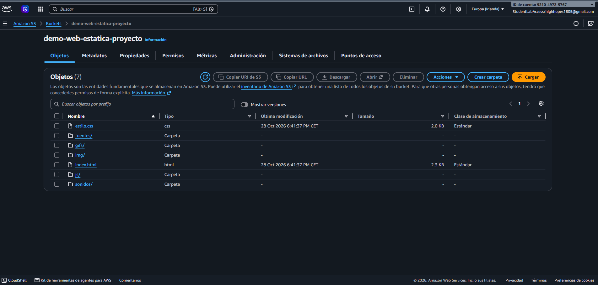

### 3. Habilitación de alojamiento de sitios web estáticos

En la pestaña **Propiedades** del bucket → **Alojamiento de sitios web estáticos** → **Editar**:

- **Alojamiento de sitios web estáticos:** Habilitar
- **Tipo de alojamiento:** Alojar un sitio web estático
- **Documento de índice:** `index.html`

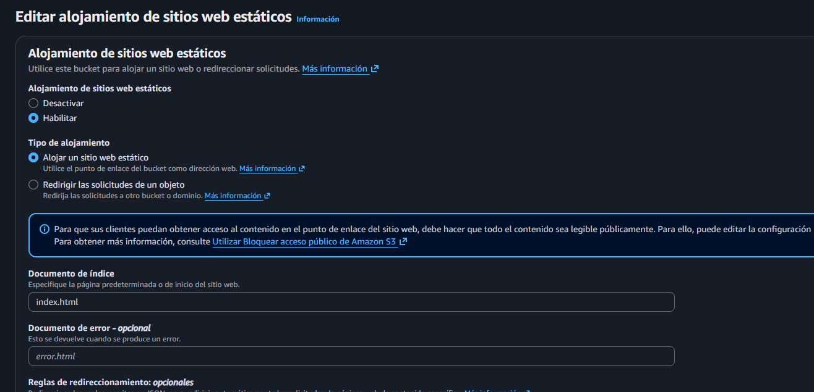

AWS avisa de que, para que el contenido sea accesible desde el punto de enlace del sitio web, el bucket debe permitir lectura pública.

Una vez habilitado, S3 genera el **punto de enlace del sitio web (website endpoint)**:

🔗 **http://demo-web-estatica-proyecto.s3-website-eu-west-1.amazonaws.com**

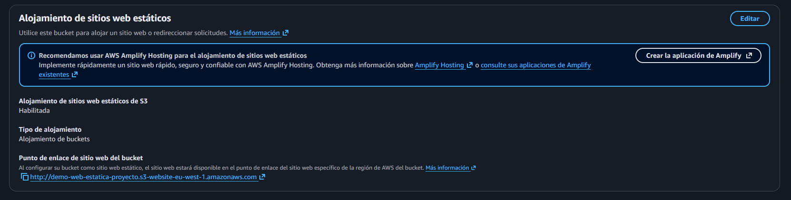

Al visitarlo, el navegador avisa de que el sitio **no tiene conexión segura (HTTPS)**:

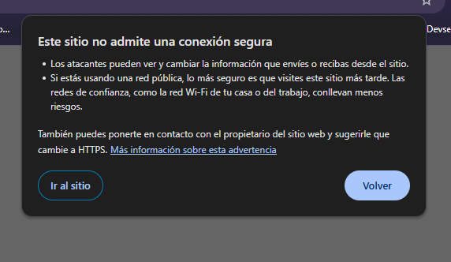

Esto ocurre porque los *endpoints* de S3 Website Hosting **solo sirven contenido por HTTP**, nunca HTTPS. Este es precisamente el motivo por el que se añade **CloudFront** por delante del bucket en el siguiente paso: para servir el sitio con HTTPS (mediante un certificado de ACM) y mejorar el rendimiento con CDN.

**Motivo adicional: coste por tráfico directo a S3.** Cada visita/recarga de la web genera peticiones `GET` contra el bucket, y S3 cobra tanto por **solicitudes** (por cada 1.000 peticiones) como por **transferencia de datos saliente** (por GB servido a internet) — no solo por almacenamiento:

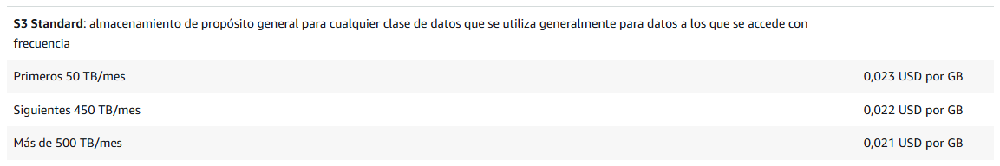

Con tráfico recurrente o archivos pesados (vídeo, imágenes grandes), servir el contenido directamente desde S3 sin caché dispara ese coste en cada recarga. **CloudFront** cachea el contenido en ubicaciones *edge*, por lo que las visitas repetidas se sirven desde la caché sin llegar al bucket origen, reduciendo tanto las solicitudes como la transferencia de datos facturadas a S3.

### 4. Configuración de permisos del bucket

Al visitar el endpoint del sitio web aparece un error **403 Forbidden / AccessDenied**, porque el bucket sigue siendo privado por defecto.

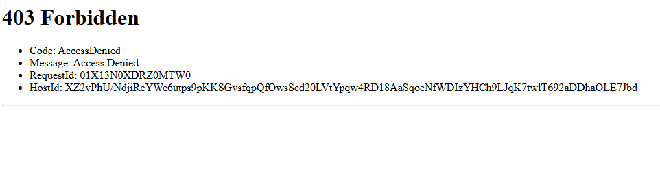

**4.1. Desactivar "Bloquear acceso público"** — pestaña **Permisos** → *Bloquear acceso público (configuración del bucket)* → Editar:

| Antes (todo bloqueado) | Después (todo desactivado) |
|---|---|
| 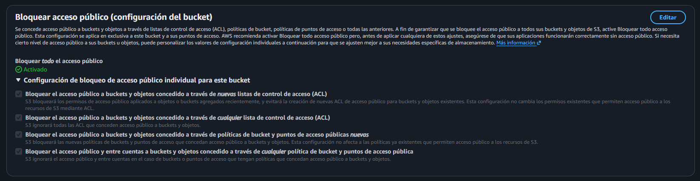 | 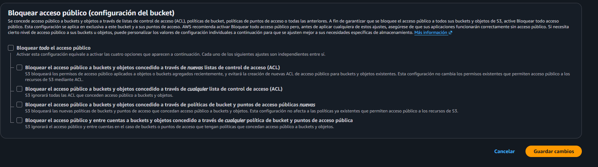 |

AWS pide confirmar la acción escribiendo `confirmar`, ya que puede hacer públicos los objetos del bucket:

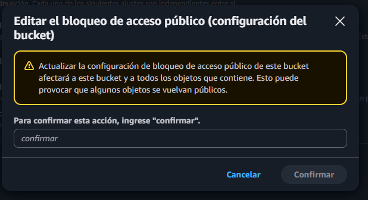

**4.2. Añadir una Bucket Policy de lectura pública** — tras desactivar el bloqueo, seguía apareciendo el error 403: faltaba conceder explícitamente el permiso de lectura mediante una política de bucket (`Permisos` → `Política de bucket` → Editar):

```json
{
  "Version": "2012-10-17",
  "Statement": [
    {
      "Sid": "PublicReadForStaticWebsite",
      "Effect": "Allow",
      "Principal": "*",
      "Action": "s3:GetObject",
      "Resource": "arn:aws:s3:::demo-web-estatica-proyecto/*"
    }
  ]
}
```

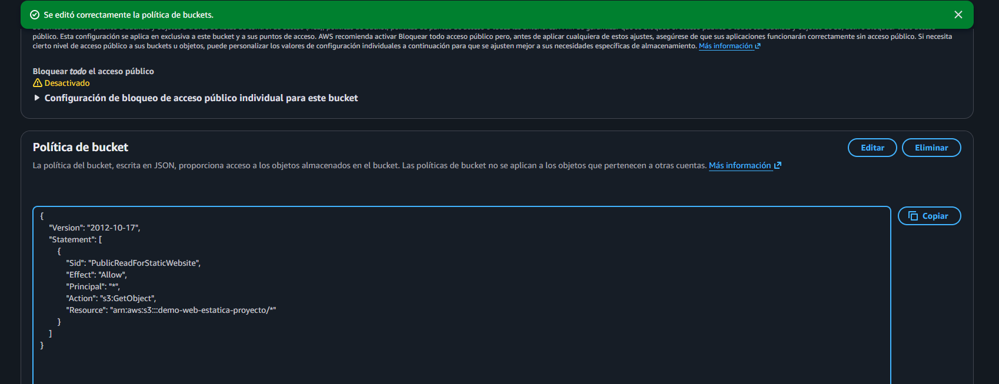

AWS confirma *"Se editó correctamente la política de buckets"*, con el **Bloqueo de acceso público: Desactivado** y el `Resource` ya apuntando al bucket correcto (`demo-web-estatica-proyecto`). Con esto, el bucket permite lectura pública de los objetos (`s3:GetObject`) a cualquiera, necesaria para que el endpoint de Static Website Hosting sirva el contenido correctamente.

**Resultado:** la web ya carga correctamente, sin error 403, sin scroll vertical y con el reproductor de audio funcionando:

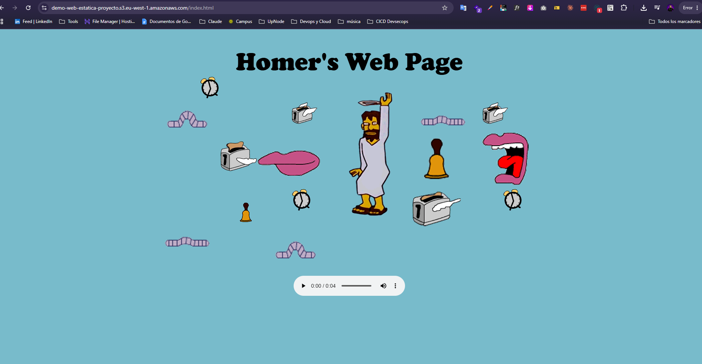

**Conclusión de la Parte 1:** la web funciona, pero con dos problemas de fondo:
- ❌ **Sin HTTPS** — el endpoint de S3 no soporta SSL/TLS.
- ❌ **Coste por tráfico directo** — cada recarga genera solicitudes y transferencia de datos facturadas directamente contra el bucket, sin ningún tipo de caché.

## 🥈 Parte 2: Cómo alojar una web estática correctamente (con CloudFront)

Para corregir las limitaciones de la Parte 1, se coloca **Amazon CloudFront** delante del bucket: añade HTTPS mediante un certificado de **ACM** y cachea el contenido en ubicaciones *edge*, reduciendo las peticiones y la transferencia de datos que llegan a S3.

### 5. Revertir la configuración pública del bucket

Antes de meter CloudFront por delante, se deshace la configuración pública aplicada en la Parte 1, ya que el bucket debe volver a quedar **privado**: el acceso a partir de ahora lo gestionará únicamente CloudFront mediante **Origin Access Control (OAC)**, no el propio bucket.

Pasos realizados, en orden inverso a como se configuraron:

1. **Eliminar la Bucket Policy** de lectura pública (`Permisos` → `Política de bucket` → `Eliminar`), que concedía `s3:GetObject` a cualquiera (`Principal: "*"`).
2. **Reactivar "Bloquear todo el acceso público"** (`Permisos` → *Bloquear acceso público (configuración del bucket)* → `Editar` → marcar las 4 opciones → confirmar).
3. **Deshabilitar el Alojamiento de sitios web estáticos** (`Propiedades` → *Alojamiento de sitios web estáticos* → `Editar` → `Desactivar`), ya que el *website endpoint* de S3 no se usará: CloudFront accederá al bucket por el endpoint REST estándar mediante OAC.

Con esto, el bucket vuelve a estar completamente privado y el *website endpoint* generado en la Parte 1 deja de responder — tal y como exige la arquitectura con OAC + Bucket Policy restrictiva del diagrama inicial.

### 6. Creación de la distribución de CloudFront

Se busca **CloudFront** en la consola de AWS y se accede a `Distributions` → `Create distribution`.

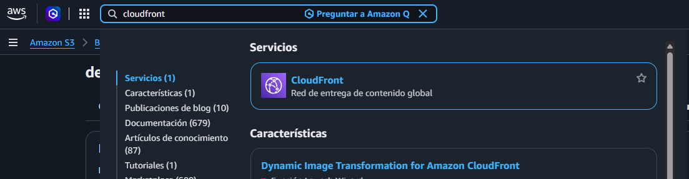

**Paso 1 — Choose a plan:** CloudFront ofrece dos modelos de precio:

- **Flat-rate plans** — precio mensual fijo (desde $0/mes el plan Free) que incluye CDN, WAF, protección DDoS, DNS y logging, con tope de gasto previsible.
- **Pay as you go** — precio variable según el uso real (tráfico y peticiones), sin cuota fija ni techo de gasto.

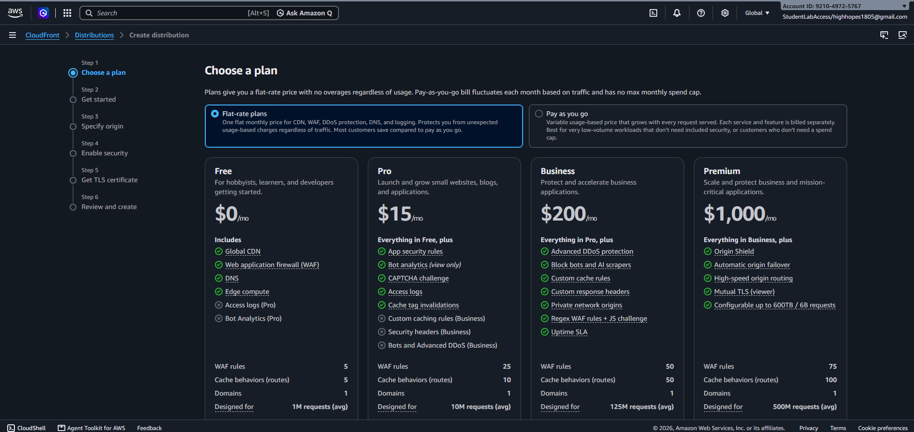

Se elige **Pay as you go**, ya que para este proyecto (tráfico bajo y puntual) resulta más económico pagar solo por lo que se consume en lugar de una cuota fija mensual.

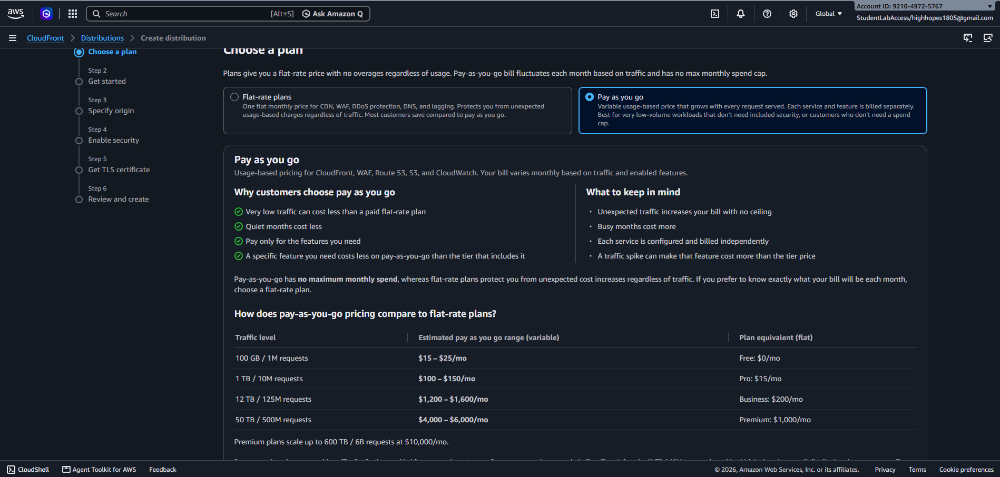

**Paso 3 — Specify origin:** se elige el tipo de origen **Amazon S3**, ya que el contenido estático (ficheros y assets del sitio) vive en el bucket creado en la Parte 1.

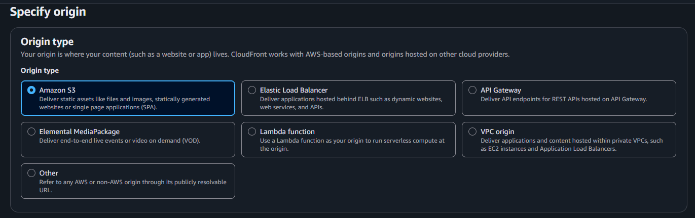

- **Origin path:** `/` (vacío/raíz) — no se añade ningún prefijo, ya que `index.html` y el resto de ficheros están directamente en la raíz del bucket (ver [paso 2](#2-subida-de-los-ficheros-del-sitio)).

**Settings** — se dejan las opciones recomendadas por defecto:

- ✅ **Allow private S3 bucket access to CloudFront (Recommended)** — esto es justo lo que implementa el diagrama de arquitectura original: CloudFront crea y gestiona automáticamente un **Origin Access Control (OAC)**, y actualiza la **Bucket Policy** del bucket para que solo acepte peticiones que vengan en nombre de esta distribución de CloudFront, bloqueando cualquier otro acceso directo.
- **Origin settings:** Use recommended origin settings.
- **Cache settings:** Use recommended cache settings tailored to serving S3 content.

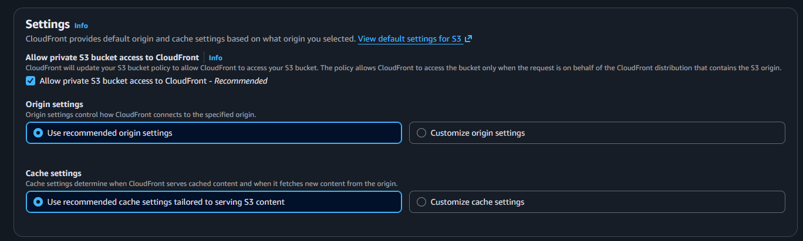

**Paso 4 — Enable security:** se **deshabilita AWS WAF** (Web Application Firewall). Aunque añade protección extra (reglas, bloqueo de bots, etc.), tiene un coste adicional elevado que no se justifica para este proyecto de demostración con tráfico bajo.

**Pasos 5 y 6 — Get TLS certificate / Review and create:** se revisa la configuración y se pulsa **Create distribution**, dejando el certificado TLS por defecto de CloudFront (dominio `*.cloudfront.net`), ya que de momento no se usa un dominio personalizado.

Al crear la distribución con **"Allow private S3 bucket access to CloudFront"** activado, AWS genera automáticamente la **Bucket Policy** necesaria para que únicamente esa distribución de CloudFront (identificada por su OAC) pueda leer del bucket:

```json
{
  "Version": "2008-10-17",
  "Id": "PolicyForCloudFrontPrivateContent",
  "Statement": [
    {
      "Effect": "Allow",
      "Principal": {
        "Service": "cloudfront.amazonaws.com"
      },
      "Action": "s3:GetObject",
      "Resource": "arn:aws:s3:::demo-web-estatica-proyecto/*",
      "Condition": {
        "ArnLike": {
          "AWS:SourceArn": "arn:aws:cloudfront::<ACCOUNTID>:distribution/<DISTRIBUTION-ID>"
        }
      }
    }
  ]
}
```

Esta política (pegada en `Permisos` → `Política de bucket` del bucket) es la pieza clave de la arquitectura con OAC: a diferencia de la política pública de la Parte 1 (`Principal: "*"`), aquí el `Principal` está restringido al **servicio CloudFront** (`cloudfront.amazonaws.com`), y la condición `AWS:SourceArn` limita el acceso **únicamente a esta distribución concreta** (sustituyendo `<ACCOUNTID>` y `<DISTRIBUTION-ID>` por los valores reales). El bucket sigue siendo privado — nadie puede acceder a los objetos directamente, solo a través de esta distribución de CloudFront.

**Distribución creada** (`frontend`), con su dominio generado por CloudFront:

🔗 **https://d1mfi71h3wqbg9.cloudfront.net**

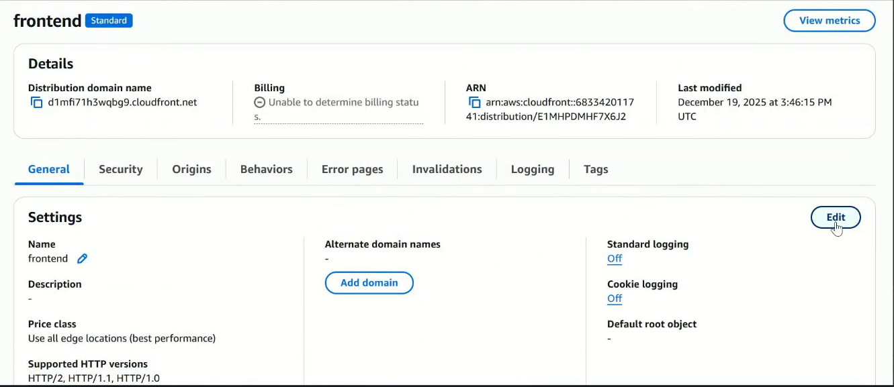

**Problema:** al visitar la URL raíz de ese dominio no se mostraba la web. Con `Origin path` en `/`, CloudFront no sabe qué fichero servir por defecto al pedir la raíz (`/`) — a diferencia de S3 Website Hosting, CloudFront **no asume `index.html` automáticamente**.

**Solución:** en la distribución → pestaña **General** → **Settings** → `Edit` → campo **Default root object**, se añade `index.html`. Así CloudFront devuelve ese fichero cuando se solicita la raíz del sitio.

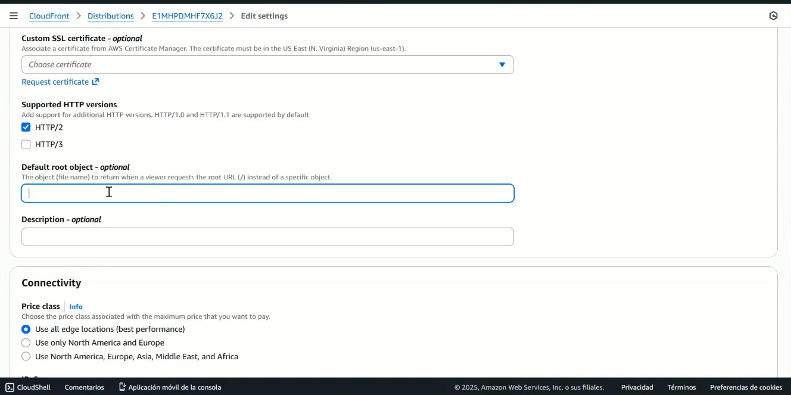

Tras guardar, la web ya se sirve correctamente desde el dominio de CloudFront — ahora sí con HTTPS.

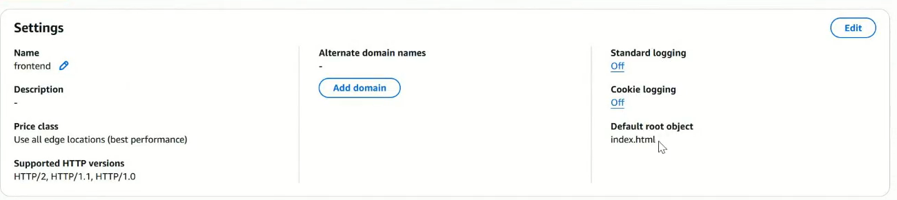

**Configuración de Error Pages:** en la pestaña `Error pages` de la distribución → `Create custom error response`:

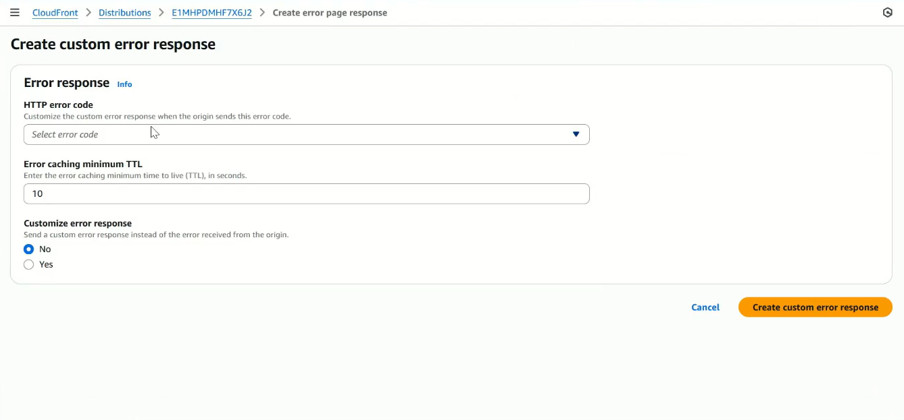

- **HTTP error code:** `403: Forbidden`
- **Error caching minimum TTL:** `10` segundos
- **Customize error response:** `Yes`
  - **Response page path:** `/index.html`
  - **HTTP Response code:** `200: OK`

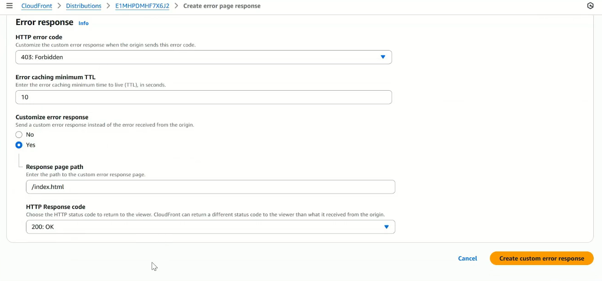

Con esto, cualquier **403** devuelto por el origen (por ejemplo al pedir una ruta que no existe en el bucket) se traduce en servir `index.html` con un código **200 OK**, en vez de mostrar al usuario el XML de error crudo de S3.

### 7. Configuración de HTTPS / certificado SSL

A diferencia del endpoint de S3 (sin HTTPS), **CloudFront sirve el sitio en HTTPS desde el momento en que se crea la distribución**, sin configuración adicional: usa automáticamente un **certificado SSL/TLS por defecto de CloudFront** para su dominio `*.cloudfront.net`, sin coste extra y sin pasar por ACM.

🔒 **https://d1mfi71h3wqbg9.cloudfront.net** — ya accesible con HTTPS.

> El certificado por defecto solo cubre el dominio `*.cloudfront.net`. Para usar un **dominio propio** (paso 8) haría falta solicitar un certificado en **AWS Certificate Manager (ACM)**, obligatoriamente en la región `us-east-1` (N. Virginia), y asociarlo a la distribución.

### 8. Configuración de dominio personalizado (opcional)

**8.1. Zona alojada en Route 53** — en `Route 53` → `Zonas hospedadas` ya existe una **zona alojada pública** para el dominio del laboratorio, `683342011741.realhandsonlabs.net` (subdominio con el ID de cuenta, provisto por el entorno de prácticas), con sus registros **NS** y **SOA** por defecto:

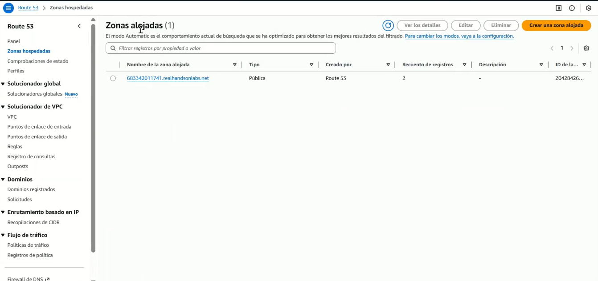

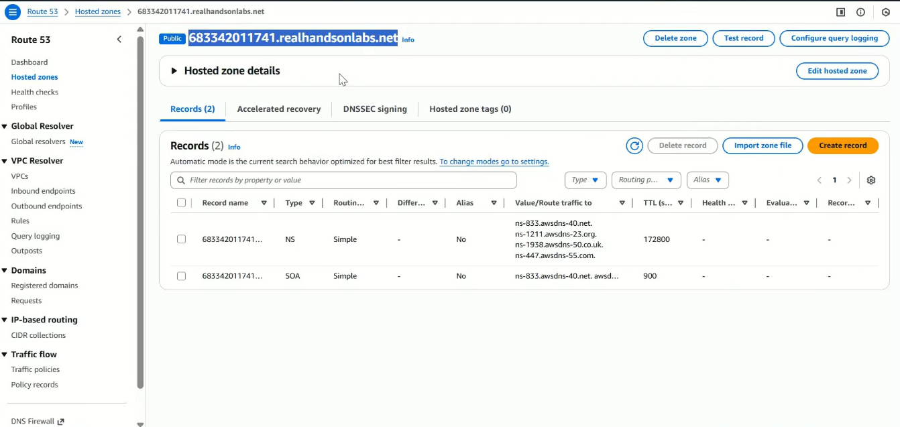

**8.2. Solicitar certificado en ACM** — se busca **Certificate Manager (ACM)** en la consola:

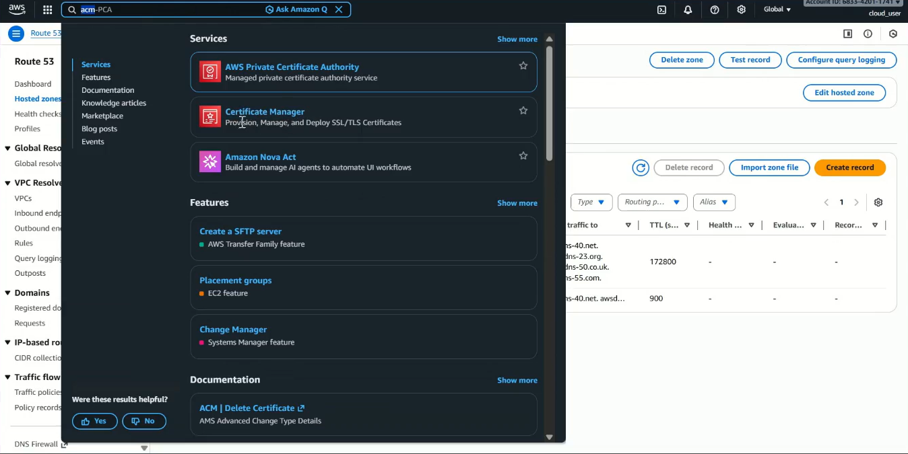

> ⚠️ Recordatorio: el certificado debe solicitarse en la región **`us-east-1` (N. Virginia)**, el único lugar donde ACM emite certificados que CloudFront puede usar.

Se pulsa **Request a certificate** → **New ACM managed certificate**:

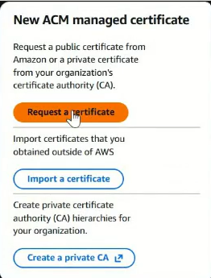

En el asistente se configura:

- **Certificate type:** Request a **public certificate**.
- **Fully qualified domain name:** el dominio (o subdominio) sobre `683342011741.realhandsonlabs.net` que usará la web.
- El resto de opciones (validación DNS, tipo de clave, etc.) se dejan **por defecto**.

**8.3. Crear el registro en Route 53** — en la zona hospedada `683342011741.realhandsonlabs.net` → `Create record` (método **Quick create**):

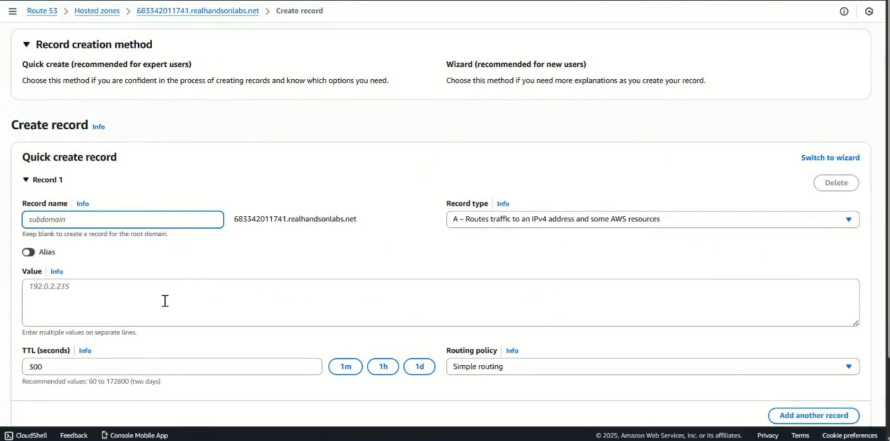

- **Record name:** el subdominio elegido (ej. `www`, dejar en blanco para usar el dominio raíz).
- **Record type:** **CNAME** — un registro que hace que el (sub)dominio **apunte a otro dominio** en vez de a una IP directa; en este caso, apuntará al dominio de la distribución de CloudFront (`d1mfi71h3wqbg9.cloudfront.net`) en lugar de a una IP fija.
- **Value:** el dominio de CloudFront al que debe redirigir.
- **TTL:** `300` segundos (valor por defecto).
- **Routing policy:** Simple routing.

> Se usa CNAME (en vez de un registro A con IP) precisamente porque CloudFront no expone una IP fija: su dominio puede cambiar de IPs por detrás, así que el DNS debe apuntar al **nombre de dominio** de la distribución, no a una dirección concreta.

**8.4. Esperar la validación del certificado** — ACM valida la propiedad del dominio mediante un registro **CNAME de validación** (distinto del CNAME del paso anterior) que añade automáticamente a la zona de Route 53. Mientras tanto, el certificado queda en estado **"Pending validation"**.

⏳ Hay que esperar a que ACM confirme la validación por DNS y el certificado pase a estado **"Issued"** — este proceso no es instantáneo (puede tardar varios minutos). Hasta que el certificado esté emitido (global, no solo en la región `us-east-1` donde se solicitó, sino disponible para asociarse a cualquier distribución de CloudFront), no se puede seleccionar en la configuración de la distribución.

**8.5. Añadir el dominio a la distribución de CloudFront** — una vez emitido el certificado, se vuelve a la distribución (`frontend`) → pestaña **General** → **Settings** → **Add domain**:

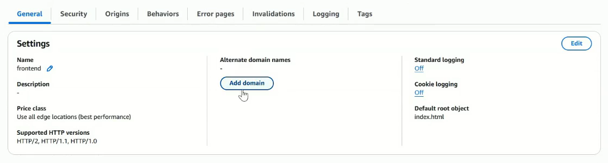

Se añade el dominio/subdominio configurado en Route 53 como **Alternate domain name (CNAME)** de la distribución, y se selecciona el certificado de ACM ya emitido. A partir de aquí, la web será accesible tanto desde `d1mfi71h3wqbg9.cloudfront.net` como desde el dominio personalizado, ambos con HTTPS.

**8.6. Confirmar la validación del certificado y crear el registro final en Route 53** — la zona hospedada ya muestra **4 registros**: los NS/SOA originales, más **2 registros CNAME de validación** que ACM añadió automáticamente para confirmar la propiedad del dominio:

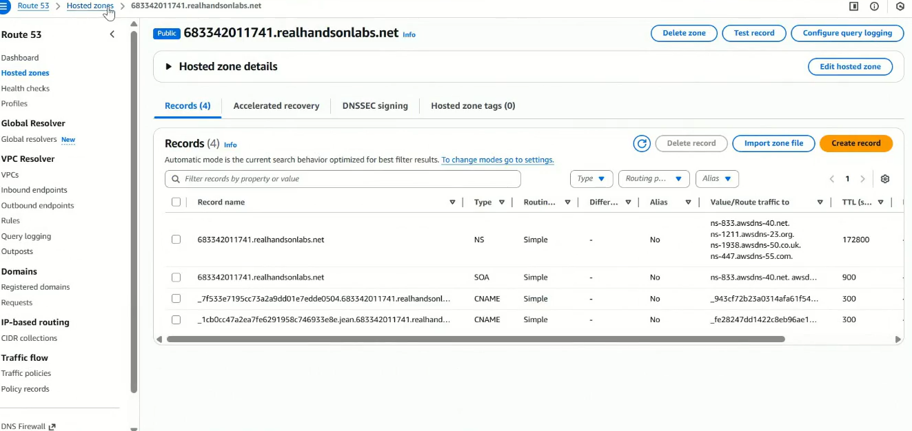

Para el registro final que apunta la web al dominio, en vez de un CNAME manual se usa un **registro tipo A con Alias**:

- **Record type:** `A`
- **Alias:** activado (`Alias to CloudFront distribution`)
- **Región:** US East (N. Virginia) — obligatoria para alias a CloudFront.
- **Route traffic to:** se elige la distribución de CloudFront (`frontend`).
- **Routing policy:** Simple routing.

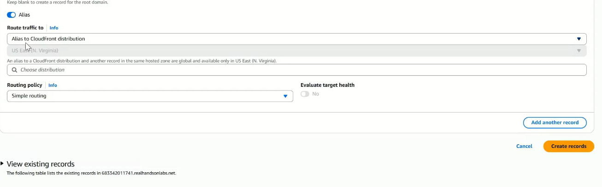

> 💡 Se prefiere un **Alias (A)** sobre un CNAME manual porque es la forma recomendada por AWS de apuntar un dominio (incluido el dominio raíz/apex, donde un CNAME no está permitido por el estándar DNS) a un recurso de AWS como CloudFront: Route 53 resuelve internamente la IP, sin coste adicional por esas consultas y sin depender de una IP fija.

Con el registro Alias creado, **la configuración de dominio personalizado y HTTPS queda completa**: el sitio es accesible mediante el dominio propio sobre `683342011741.realhandsonlabs.net`, servido por CloudFront con certificado SSL/TLS válido.

## 📸 Capturas de pantalla

> Las capturas se añadirán en la carpeta [`screenshots/`](screenshots/) y se irán enlazando aquí a medida que avancemos.

## 💰 Costes estimados

_Pendiente de documentar (estimación de costes de S3 + CloudFront según tráfico esperado)._

## 🧹 Limpieza de recursos

_Pendiente de documentar (pasos para eliminar los recursos de AWS y evitar costes innecesarios)._

## 📚 Recursos y enlaces útiles

_Pendiente de añadir enlaces a documentación oficial de AWS consultada durante el proyecto._

## 👤 Autoría

Proyecto creado por **Cristina Cañadas Gómez - Limón**

🔗 [LinkedIn](https://www.linkedin.com/in/cristina-gomez-limon/)
